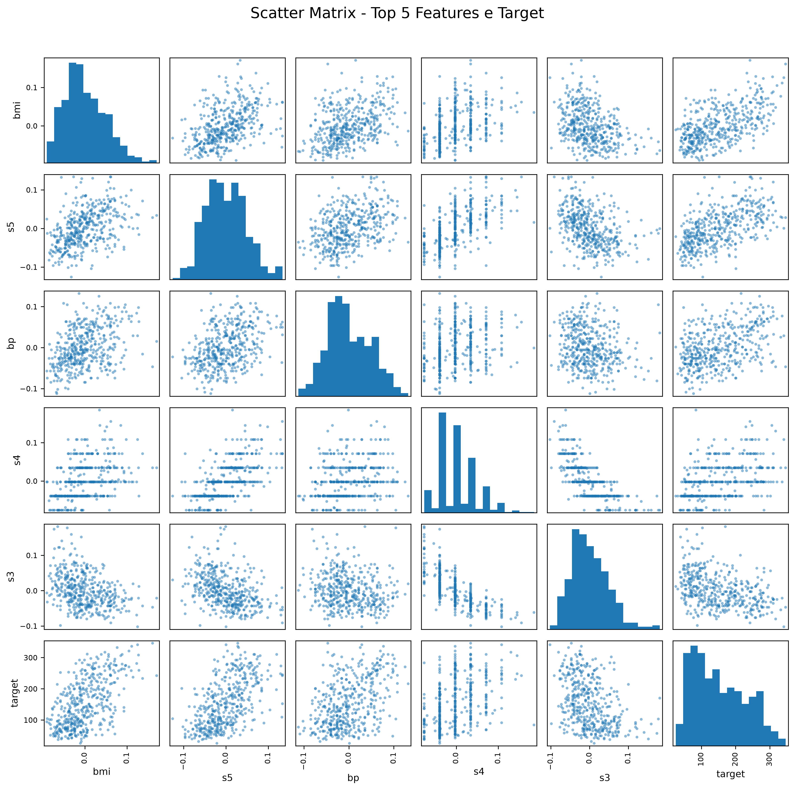
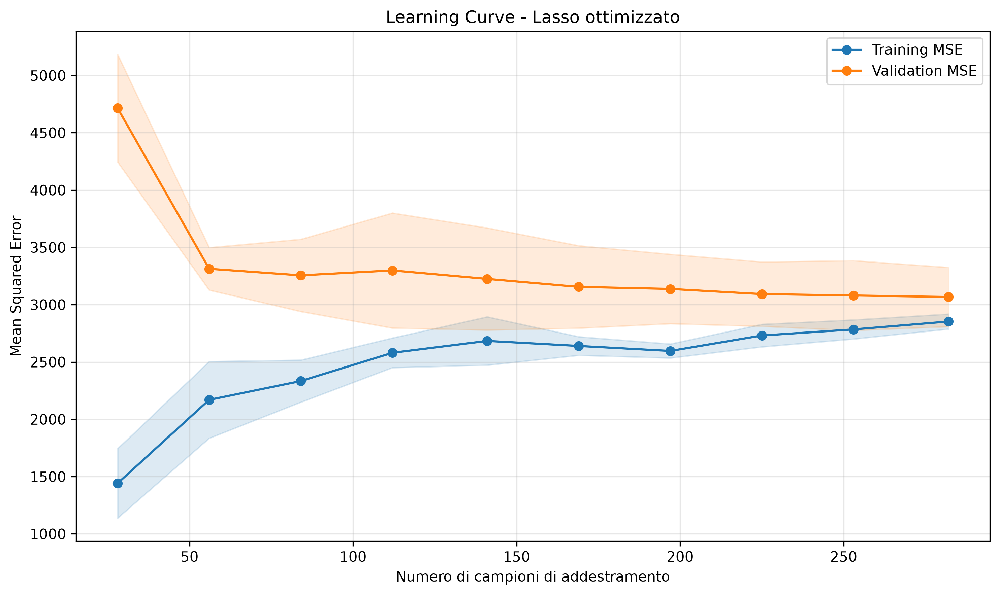
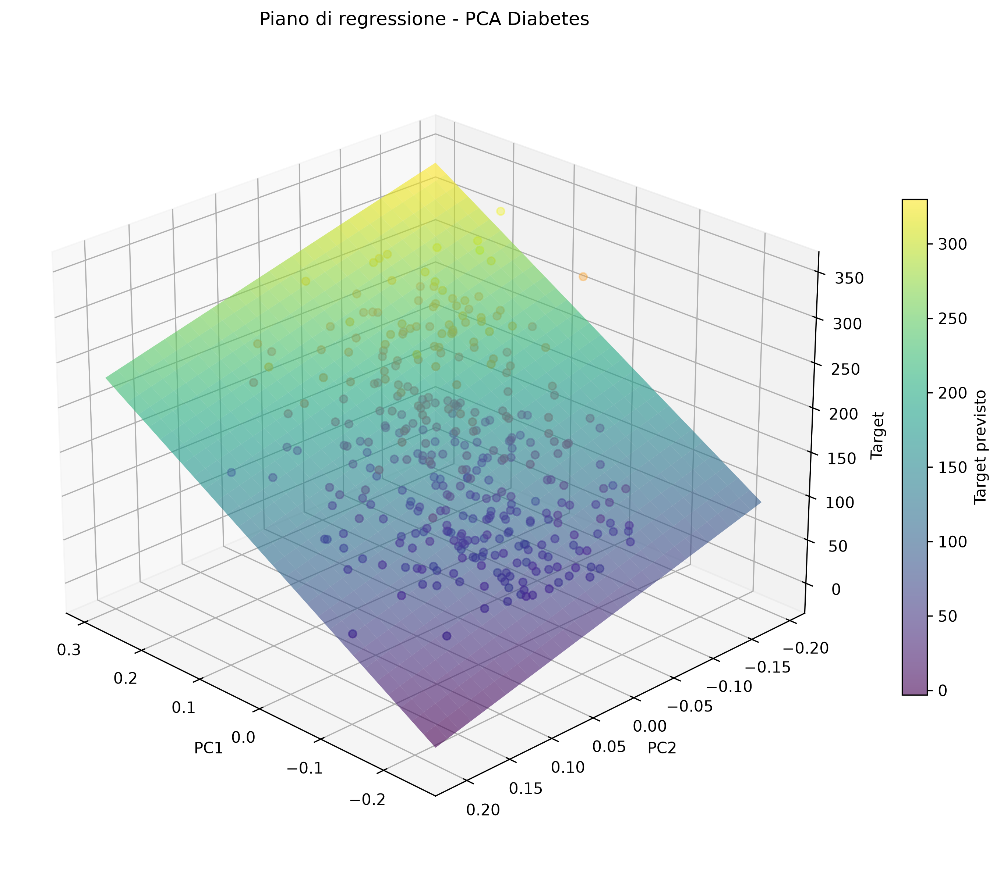

# Progetto Finale M3 – Machine Learning per la Regressione

**Dataset:** Diabetes – Scikit-learn 
**Obiettivo:** esplorare un dataset di regressione, confrontare diversi algoritmi, ottimizzare un modello e valutarne la capacità di generalizzazione.

---

## 1. Panoramica del progetto

Questo progetto applica una pipeline di Machine Learning al dataset Diabetes messo a disposizione da Scikit-learn.

Il dataset contiene **442 osservazioni**, **10 caratteristiche** e una variabile target numerica. Il target rappresenta una misura quantitativa della progressione della malattia un anno dopo la rilevazione iniziale: il problema viene quindi affrontato come un’attività di **regressione**, non di classificazione.

Il lavoro è organizzato in queste fasi:

1. Esplorazione e controllo dei dati.
2. Analisi descrittiva, correlazioni e individuazione dei potenziali outlier.
3. Suddivisione in Training Set e Test Set.
4. Confronto di sei modelli mediante K-Fold Cross-Validation.
5. Ottimizzazione di Lasso tramite GridSearchCV.
6. Valutazione finale sul Test Set.
7. Analisi delle Learning Curves.
8. Riduzione dimensionale con PCA e visualizzazione di un piano di regressione in 3D.

## 2. Struttura del repository

```text
Progetto-Finale-M3/
│
├── progetto_finale_m3.py
├── README.md
├── requirements.txt
│
└── output_m3/
    ├── diabetes_histograms.png
    ├── diabetes_boxplots_features.png
    ├── diabetes_boxplot_target.png
    ├── diabetes_scatter_matrix.png
    ├── diabetes_target_correlations.png
    ├── diabetes_iqr_outliers.png
    ├── diabetes_learning_curve.png
    └── diabetes_pca_regression_plane.png
```

Il file Python contiene l’intero flusso di lavoro. La cartella `output_m3` raccoglie i grafici generati durante l’esecuzione; viene creata automaticamente se non esiste.

## 3. Dataset e controlli iniziali

Il dataset viene caricato direttamente da Scikit-learn con `load_diabetes(as_frame=True)`, quindi non è necessario scaricare manualmente un file CSV.

Le prime verifiche comprendono:

- visualizzazione delle prime righe;
- statistiche descrittive con `describe()`;
- struttura e tipi delle colonne con `info()`;
- controllo dei valori mancanti.

Le caratteristiche fornite da Scikit-learn sono già centrate e riscalate secondo la preparazione originale del dataset. Nelle pipeline dei modelli sensibili alla scala viene comunque applicato `StandardScaler` all’interno della Pipeline, così che lo scaler venga adattato esclusivamente ai dati di addestramento di ciascun fold.

## 4. Esplorazione dei dati (EDA)

### Istogrammi

Sono stati generati istogrammi separati per le 10 caratteristiche e per il target, utilizzando `DataFrame.hist()`. Questa soluzione evita di sovrapporre variabili con scale differenti nello stesso istogramma.

### Boxplot

Le caratteristiche e il target sono stati rappresentati in due grafici distinti. La separazione rende più leggibili le distribuzioni, perché il target ha una scala numerica più ampia rispetto alle caratteristiche.

### Correlazioni con il target

Le correlazioni lineari osservate sono:

| Caratteristica | Correlazione con il target |
|---|---:|
| BMI | 0.586450 |
| S5 | 0.565883 |
| BP | 0.441482 |
| S4 | 0.430453 |
| S3 | -0.394789 |
| S6 | 0.382483 |
| S1 | 0.212022 |
| Age | 0.187889 |
| S2 | 0.174054 |
| Sex | 0.043062 |

BMI e S5 mostrano le associazioni lineari più elevate con il target nel dataset. La correlazione descrive un’associazione statistica e **non dimostra un rapporto di causalità**.

### Scatter matrix: scelta delle variabili visualizzate

La prima scatter matrix comprendeva tutte le 10 caratteristiche e il target: una matrice di 11 × 11 grafici (121 riquadri), risultata troppo affollata per una lettura efficace.

Per rendere la visualizzazione più chiara, la scatter matrix finale mostra le **cinque caratteristiche con correlazione assoluta più elevata rispetto al target** — BMI, S5, BP, S4 e S3 — insieme al target, ottenendo una matrice di 6 × 6 grafici.

Questa selezione riguarda **esclusivamente la visualizzazione**: nessuna caratteristica è stata eliminata da `X` e tutti e 10 gli attributi sono rimasti disponibili per l’addestramento e il confronto dei modelli.

### Individuazione dei potenziali outlier con IQR

È stata applicata la regola dell’Interquartile Range:

- `IQR = Q3 - Q1`
- limite inferiore: `Q1 - 1.5 × IQR`
- limite superiore: `Q3 + 1.5 × IQR`

Il numero di valori individuati per variabile è:

| Variabile | Potenziali outlier |
|---|---:|
| Age | 0 |
| Sex | 0 |
| BMI | 3 |
| BP | 0 |
| S1 | 8 |
| S2 | 7 |
| S3 | 7 |
| S4 | 2 |
| S5 | 4 |
| S6 | 9 |
| Target | 0 |

Gli outlier sono stati **segnalati ma non rimossi automaticamente**. Un valore esterno ai limiti IQR non è necessariamente un errore: può rappresentare un’osservazione reale. Il totale delle segnalazioni per variabile non corrisponde necessariamente al numero di pazienti distinti, perché lo stesso paziente può essere anomalo in più caratteristiche.

## 5. Preparazione dei dati e validazione

Il dataset è stato suddiviso con `train_test_split`:

- **80% Training Set:** 353 osservazioni;
- **20% Test Set:** 89 osservazioni.

La divisione utilizza `random_state=42` per rendere riproducibile la suddivisione.

Il Test Set è stato tenuto da parte durante il confronto dei modelli e la ricerca degli iperparametri. È stato utilizzato soltanto per la valutazione finale.

Per il confronto è stata utilizzata una **K-Fold Cross-Validation a 5 fold**, con mescolamento dei dati (`shuffle=True`) e `random_state=42`.

La metrica utilizzata è `neg_mean_squared_error`. Scikit-learn restituisce il MSE con segno negativo perché la convenzione degli scorer prevede che un punteggio più alto sia migliore. I valori sono stati quindi moltiplicati per -1 per riportarli al normale MSE positivo, più facile da interpretare: **a parità di condizioni, un MSE più basso indica un errore quadratico medio inferiore**.

## 6. Confronto dei modelli

Sono stati confrontati sei algoritmi di regressione:

- Linear Regression;
- Decision Tree Regressor;
- Ridge Regression;
- Lasso Regression;
- K-Nearest Neighbors Regressor;
- Support Vector Regression (SVR).

Per Ridge, Lasso, KNN e SVR è stata utilizzata una `Pipeline` contenente `StandardScaler` e il rispettivo modello. In questo modo, durante la Cross-Validation, la standardizzazione viene adattata sui soli dati di training di ciascun fold, evitando data leakage.

Risultati della Cross-Validation sul Training Set:

| Modello | MSE medio | Deviazione standard |
|---|---:|---:|
| **Lasso** | **3069.61** | 264.12 |
| Ridge | 3071.93 | 266.42 |
| Linear Regression | 3074.14 | 265.19 |
| KNN | 3870.52 | 461.44 |
| SVR | 5368.69 | 795.64 |
| Decision Tree | 6563.15 | 1458.94 |

Lasso ha ottenuto il MSE medio più basso nella prima comparazione. Ridge e Linear Regression hanno risultati molto vicini: la differenza fra i primi tre modelli è contenuta. La deviazione standard descrive la variabilità dei risultati tra i fold; non è una seconda misura dell’errore medio.

## 7. Ottimizzazione di Lasso con GridSearchCV

Lasso è stato scelto per la fase di ottimizzazione perché ha ottenuto il MSE medio più basso nel confronto iniziale.

È stata utilizzata `GridSearchCV` per provare **50 valori di `alpha`**, generati con `np.logspace(-4, 1, 50)`, mantenendo la Cross-Validation a 5 fold e la metrica `neg_mean_squared_error`.

Il miglior parametro individuato è:

```text
alpha = 0.5963623316594643
```

Il miglior MSE medio in Cross-Validation restituito dalla ricerca è:

```text
3068.9579490914293
```

Il miglioramento rispetto al Lasso iniziale è contenuto, ma la ricerca ha identificato una configurazione leggermente migliore all’interno dell’intervallo di valori esaminato.

## 8. Valutazione finale sul Test Set

Dopo la selezione di `alpha`, `GridSearchCV` ha riaddestrato il miglior stimatore sull’intero Training Set (`refit=True`, comportamento predefinito). Il modello è stato poi valutato sul Test Set, mai utilizzato durante l’ottimizzazione.

| Metrica | Risultato |
|---|---:|
| MSE sul Test Set | **2850.39** |
| R² sul Test Set | **0.4620** |

Il valore di R² indica che il modello spiega circa il 46.2% della variabilità osservata nel target sul Test Set. Non è una percentuale di previsioni corrette: si tratta di un problema di regressione, non di classificazione.

Il risultato sul Test Set può essere diverso dalla media della Cross-Validation perché si riferisce a un insieme specifico di osservazioni, mentre la Cross-Validation media cinque verifiche su suddivisioni differenti del Training Set.

## 9. Learning Curve

La Learning Curve è stata calcolata per il Lasso ottimizzato, utilizzando quantità crescenti di campioni di training e una validazione a 5 fold.

Sono state confrontate:

- la curva del MSE sui dati di addestramento;
- la curva del MSE sui dati di validazione.

L’andamento osservato mostra che l’errore di validazione diminuisce all’aumentare dei dati, mentre le due curve tendono progressivamente ad avvicinarsi. La distanza residua tra gli errori suggerisce che rimane una differenza tra prestazioni sui dati di training e di validazione. La Learning Curve è stata usata per discutere bias, varianza, underfitting e overfitting, senza dedurre queste condizioni da un singolo valore isolato.

## 10. PCA e piano di regressione 3D

La PCA è stata adattata esclusivamente sulle caratteristiche del Training Set e poi applicata al Test Set con la stessa trasformazione.

Le prime due componenti conservano complessivamente circa il **54.54% della variabilità** delle caratteristiche:

| Componente | Varianza spiegata |
|---|---:|
| PC1 | 39.84% |
| PC2 | 14.70% |
| **Totale** | **54.54%** |

Per la visualizzazione è stato addestrato un modello `LinearRegression` utilizzando PC1 e PC2. Il piano tridimensionale mostra:

- i punti dei pazienti del Training Set, con le coordinate PC1 e PC2 e il target osservato;
- la superficie del piano, che rappresenta il target stimato dal modello lineare nello spazio delle due componenti.

Questo modello PCA è **un’analisi visiva separata** e non sostituisce il Lasso ottimizzato, che rimane il modello scelto e valutato sulle 10 caratteristiche originali.

## 11. Grafici prodotti

Tutti i grafici sono salvati nella cartella `output_m3` in formato PNG a 300 DPI.

| File | Contenuto |
|---|---|
| `diabetes_histograms.png` | Distribuzione delle caratteristiche e del target |
| `diabetes_boxplots_features.png` | Boxplot delle 10 caratteristiche |
| `diabetes_boxplot_target.png` | Boxplot del target |
| `diabetes_scatter_matrix.png` | Scatter matrix delle cinque caratteristiche selezionate e del target |
| `diabetes_target_correlations.png` | Correlazioni delle caratteristiche con il target |
| `diabetes_iqr_outliers.png` | Conteggio dei potenziali outlier per variabile |
| `diabetes_learning_curve.png` | Learning Curve del Lasso ottimizzato |
| `diabetes_pca_regression_plane.png` | Piano di regressione 3D sulle prime due componenti PCA |

<details>
<summary><strong>Visualizza la scatter matrix ridotta</strong></summary>



</details>

<details>
<summary><strong>Visualizza la Learning Curve</strong></summary>



</details>

<details>
<summary><strong>Visualizza il piano di regressione PCA in 3D</strong></summary>



</details>

## 12. Come eseguire il progetto

### Requisiti

- Python 3.10 o successivo consigliato;
- NumPy;
- Pandas;
- Matplotlib;
- Scikit-learn.

Installare le dipendenze con:

```bash
pip install -r requirements.txt
```

Eseguire il programma dalla cartella principale del progetto:

```bash
python progetto_finale_m3.py
```

Il programma carica il dataset tramite Scikit-learn, esegue i controlli, addestra e confronta i modelli, stampa le metriche e salva i grafici in `output_m3/`.

## 13. Conclusioni

Il progetto ha permesso di seguire un flusso completo di regressione: dall’esplorazione dei dati alla preparazione del training e test set, dal confronto dei modelli alla ricerca degli iperparametri, fino alla valutazione finale e alla visualizzazione con PCA.

Nel confronto iniziale, Lasso ha ottenuto il MSE medio più basso. GridSearchCV ha individuato `alpha ≈ 0.59636`. Sul Test Set il modello ha ottenuto MSE pari a 2850.39 e R² pari a 0.4620. La PCA a due componenti ha conservato il 54.54% della variabilità delle caratteristiche, offrendo una rappresentazione bidimensionale utile per costruire il piano di regressione.

Il progetto mette in evidenza anche l’importanza di separare i dati utilizzati per addestramento e selezione del modello da quelli riservati alla valutazione finale, documentando le scelte effettuate e conservando gli output grafici in una cartella dedicata.

## 14. Ringraziamenti

Desidero dedicare un ringraziamento al **professor Matteo**. Ho seguito entrambe le lezioni di correzione dei progetti e le ho trovate davvero formative: mi hanno permesso di imparare molto, non soltanto sugli aspetti tecnici, ma soprattutto su come presentare il lavoro in modo più ordinato, preciso e professionale.

In particolare, ho appreso quanto sia importante organizzare correttamente le cartelle del progetto, curare la struttura e i contenuti del README e gestire in modo chiaro gli output prodotti. Sono indicazioni che ho cercato di mettere in pratica anche in questo lavoro, prestando maggiore attenzione alla struttura complessiva e alla documentazione.

**Ringrazio sinceramente il professor Matteo per le correzioni, il tempo e gli insegnamenti condivisi. Spero che possa leggere queste righe e riconoscere, anche attraverso questo progetto, quanto i suoi suggerimenti mi siano stati utili.**

---

*Progetto realizzato nell’ambito del Modulo 3 – Machine Learning.*
